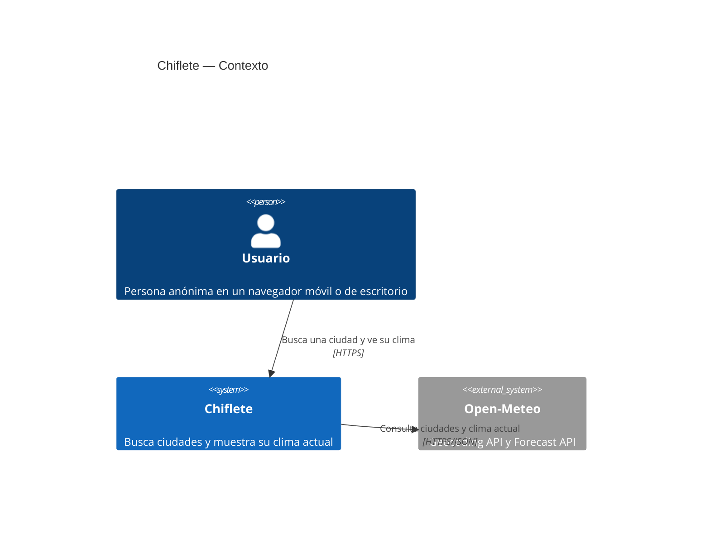
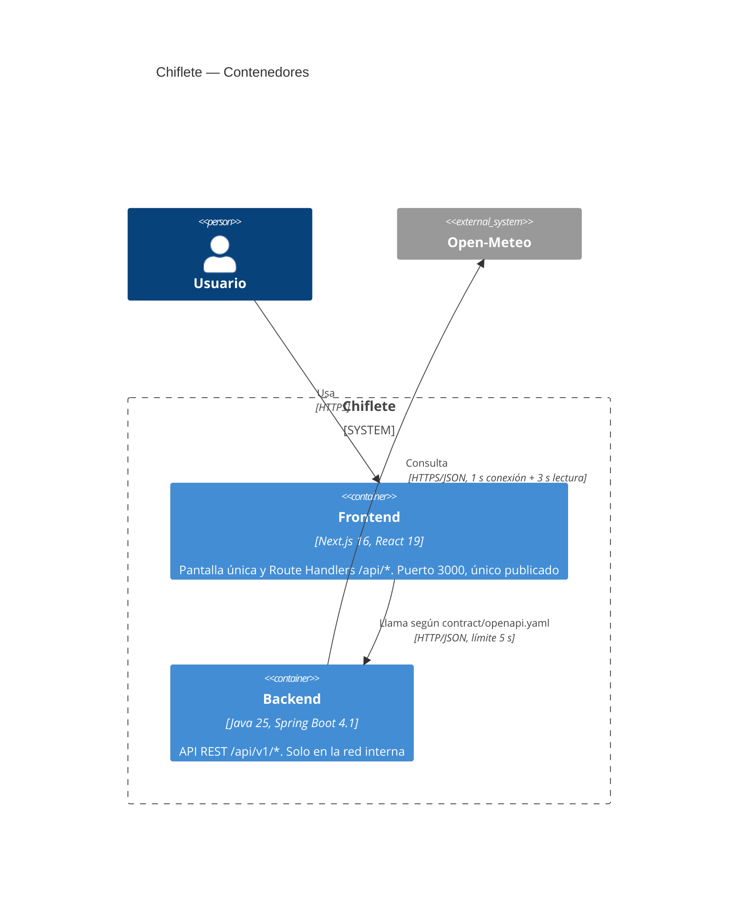
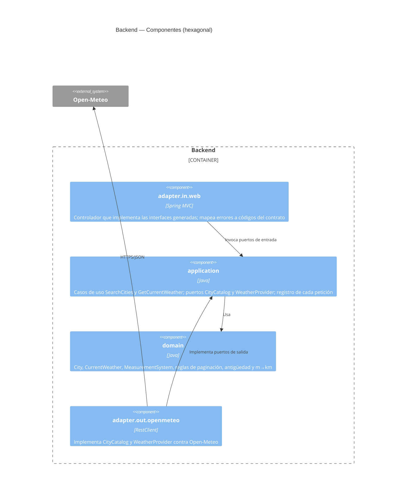

# ADR 0001: Arquitectura inicial de Chiflete

- **Estado**: Aceptado
- **Fecha**: 2026-11-09 (actualizado al cerrar la implementación de 001)
- **Funcionalidad**: [001 Clima actual por ciudad](../../specs/001-city-current-weather/spec.md)
- **Fuentes**: [plan.md](../../specs/001-city-current-weather/plan.md) y
  [research.md](../../specs/001-city-current-weather/research.md) (R1–R12)

## Contexto

Chiflete es una aplicación web pública y mobile-first. Su primera funcionalidad permite buscar
una ciudad y ver su clima actual. La constitución fija el stack (Java 25 + Spring Boot 4 en el
backend; Next.js 16 + React 19 + TypeScript `strict` + Tailwind en el frontend), exige dos
componentes desplegables separados que solo se comunican por un contrato OpenAPI, y prohíbe
almacenar datos de usuario o exponer secretos.

Los datos vienen de un proveedor externo, Open-Meteo: la Geocoding API para buscar ciudades y la
Forecast API (`current`) para el clima. No requiere clave para uso no comercial.

## Decisión

1. **Dos contenedores**: un backend Spring Boot 4.1 (Java 25, virtual threads, MVC bloqueante con
   `RestClient`) y un frontend Next.js 16 (App Router).
2. **El navegador solo habla con Next.js**. Los Route Handlers de Next.js (`/api/cities` y
   `/api/current-weather`) reenvían al backend, con un límite de 5 s. El backend solo es accesible
   en la red interna.
3. **Contrato único** en `contract/openapi.yaml`. El backend genera sus interfaces con
   `openapi-generator`; el frontend genera sus tipos con `openapi-typescript`. Las pruebas de
   contrato validan las respuestas contra el documento.
4. **Arquitectura hexagonal en el backend**, expresada en paquetes de un único módulo Maven y
   protegida por una prueba de arquitectura:
   - `domain`: modelo y reglas puras (paginación, antigüedad de 2 h, m→km).
   - `application`: casos de uso y puertos (`SearchCities`, `GetCurrentWeather`, `CityCatalog`,
     `WeatherProvider`).
   - `adapter.in.web`: controlador que implementa las interfaces generadas.
   - `adapter.out.openmeteo`: clientes de Open-Meteo.
5. **Sin persistencia ni caché**. Cada petición del backend hace una sola llamada al proveedor:
   el clima se pide con las coordenadas de la ciudad elegida.
6. **Observabilidad con lo que trae Spring Boot**: logs ECS por petición y métricas de Actuator
   por endpoint. Ni el texto de búsqueda ni IPs aparecen en logs o métricas.
7. **Entorno local con docker-compose**: solo se publica el puerto 3000 del frontend.

## Diagramas C4

### Contexto

### Contenedores

### Componentes del backend

## Alternativas consideradas

- **El navegador llama directamente al backend** (con CORS): más simple, pero expone el backend y
  dispersa el límite de 5 s y la traducción de errores. Descartada.
- **`rewrites` de Next.js en lugar de Route Handlers**: no permiten aplicar el límite de 5 s, ni
  traducir errores, ni leer `BACKEND_URL` en tiempo de ejecución. Descartada.
- **WebFlux en el backend**: la misma concurrencia que MVC con virtual threads, con un modelo de
  programación más complejo. Descartada.
- **Módulos Maven separados por capa**: más configuración de build. Los paquetes y una prueba de
  arquitectura bastan para esta versión.
- **Índice propio de ciudades (GeoNames)**: permitiría buscar por el inicio de cualquier palabra,
  pero añade almacenamiento, un proceso de actualización y una capa nueva. Descartada; el spec se
  ajustó a la búsqueda por inicio del nombre completo.
- **OpenTelemetry con colector**: más infraestructura sin un consumidor definido. Descartada.

## Consecuencias

- Las pruebas no usan la red: el proveedor se simula con `MockRestServiceServer` en el backend y
  con un backend simulado en las pruebas E2E del frontend.
- Cambiar de proveedor afecta solo a `adapter.out.openmeteo`.
- Open-Meteo exige atribución (Open-Meteo y GeoNames) y limita el uso sin clave a fines no
  comerciales. Un uso comercial requerirá su plan de pago y una clave, que deberá suministrarse
  por configuración externa (Principio IV).
- El despliegue en la nube queda fuera de este ADR y requerirá uno propio.

## Aprendido durante la implementación

- **Spring Boot 4 es modular**: `RestClient` y `spring.http.clients.*` necesitan
  `spring-boot-starter-restclient`, que no viene con `webmvc`. El código que genera
  openapi-generator 7.26 exige además `jakarta.validation-api` (solo anotaciones).
- **Errores del proveedor sin detalles**: `ProviderUnavailableException` y
  `ProviderTimeoutException` no llevan mensaje ni causa. El mensaje del cliente HTTP incluye la
  URL, con el texto buscado, y el motivo del proveedor. Un tiempo agotado de conexión o de
  lectura se traduce a `504 PROVIDER_TIMEOUT`; cualquier otro fallo, a `502 PROVIDER_UNAVAILABLE`.
- **Plazos**: con una sola llamada al proveedor (1 s de conexión + 3 s de lectura), el backend
  responde antes del límite de 5 s del frontend. Con el proveedor inaccesible, el usuario ve
  "Error interno" en algo más de 1 s.
- **El frontend también traduce sus propios fallos**: si el backend no responde en 5 s o no es
  accesible, los Route Handlers responden `504`/`502` con los mismos códigos del contrato.
- **Observabilidad**: una línea ECS por petición (`operation`, `outcome`, `durationMs` y
  `offset` o coordenadas), escrita por `OperationLog` en la capa de aplicación con la API
  fluida de SLF4J. Las métricas son las de Actuator (`http.server.requests` por endpoint y
  estado; `http.client.requests` con la plantilla de URI como etiqueta `uri`).
- **Healthcheck**: la imagen `eclipse-temurin:25-jre` no trae `curl` ni `wget`; se usa `bash`
  con `/dev/tcp`.
- **Pruebas sin red**: el validador de contrato es `openapi-request-validator-mockmvc` (nuevo
  nombre de `swagger-request-validator-mockmvc`); las pruebas de observabilidad simulan el
  proveedor con el `HttpServer` del JDK; las E2E usan un backend simulado cuyas respuestas `tsc`
  verifica contra los tipos del contrato.
